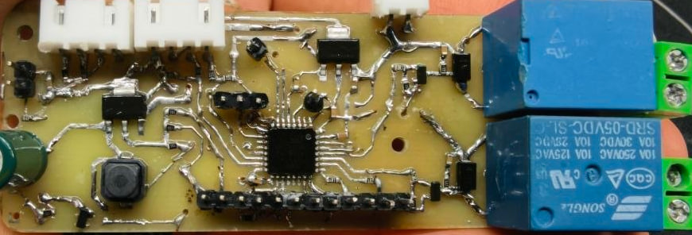
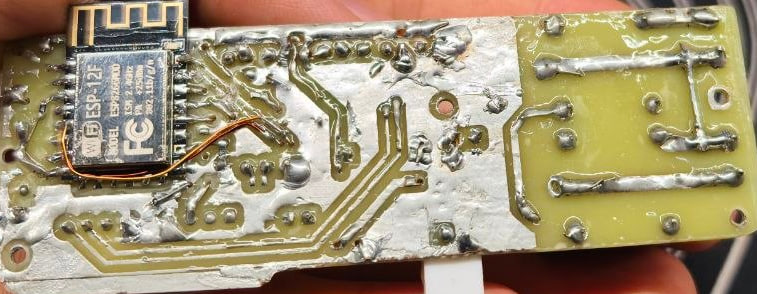
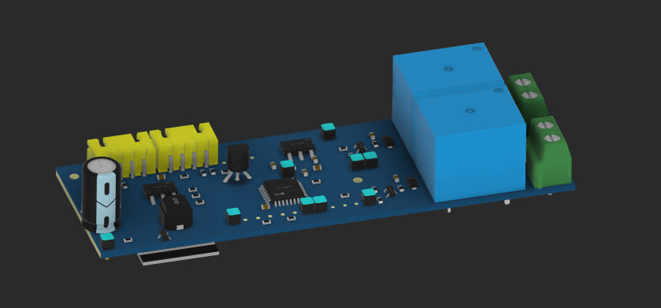
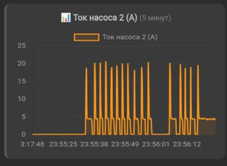
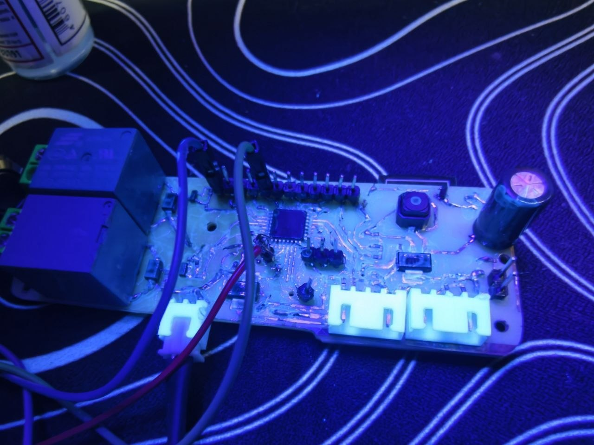
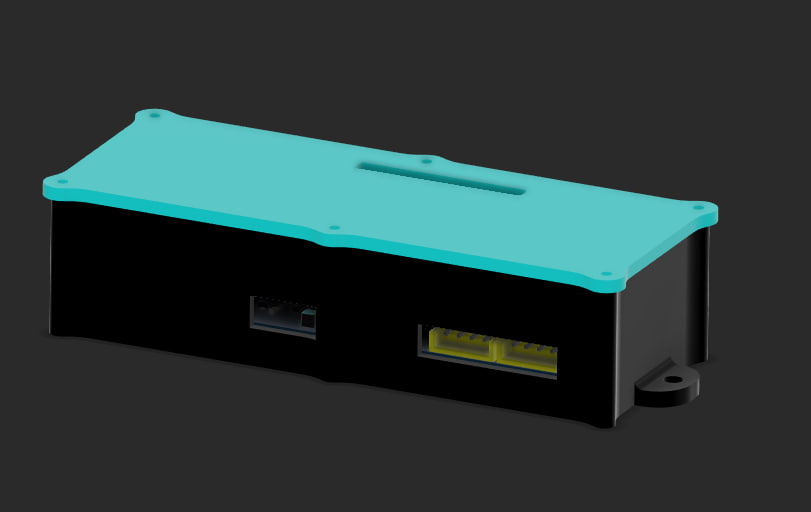

# water-station-iot

IoT-система мониторинга и управления водяной станцией на STM32F042 и ESP8266. Проект включает прошивки STM32/ESP8266, управление реле, опрос датчиков и веб-интерфейс. В репозитории также лежат схемы и Gerber-файлы печатной платы.

## Функционал

- Управление двумя насосами:
  - **Насос 1** - полив. Установлен только датчик тока. Управляется кнопкой. Если кнопку задержать на 3 секунды, то система перейдёт в аварийный режим, и насос полива будет работать всегда, вне зависимости от накопленных ошибок.
  - **Насос 2** - поддержание заданного давления воды в ресивере. Контроль по датчику давления.
- Веб-интерфейс:
  - мониторинг датчиков давления и тока;
  - прямое управление насосами через WiFi.
- Система защиты:
  - по току;
  - по давлению;
  - по времени работы.
- **Взаимно-исключающая логика:** оба насоса не могут работать одновременно.
## Важно 
Для подключения насосов и двигателей необходимо использовать контактор (пускатель) с категорией применения **AC-3**, рассчитанный на соответствующий ток и мощность нагрузки.  
> Встроенные реле на плате предназначены только для управления цепями контакторов и не допускают прямого подключения мощных насосов/двигателей, т.к. дуга быстро уничтожает контакты реле.
## Изображения 

График зависимости тока от времени. Видно, что пусковой ток доходит до 20А:

Плата покрыта защитным слоем от окисления и попадания влаги

### Комплектующие:
- STM32F042K6T6
- ESP-12F
- AMS1117 3v3 x2 (один под stm32, другой под ESP)
- PMBT3904
- WJ126V-5.0-2P x2
- XIDIBEI XDB401 i2c, 0-0.5Mpa (https://ali.click/15x0n1q)
- ACS712 30A x2
- AO3400 x2
- SRD-48VDC-SL-C x2
- Silent Switch SMD 6x6x5mm
